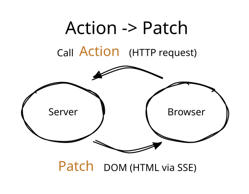

# Server-driven architecture {#architecture}

Even though Morpheus is entirely framework and architecture agnostic, its original purpose was to enable easier development of hypermedia web app architectures, where the server owns the truth and the browser gets HTML (morph-)patches and renders them with no additional layers of abstraction; as opposed to `JSON -> [vDOM ->] DOM`.

Morpheus components make it easy to run your application with just a single HTML template for each page using "fat morph" patches (see [The Tao of Datastar](https://data-star.dev/guide/the_tao_of_datastar/)).\
[Reactive signals](https://data-star.dev/guide/reactive_signals/) also allow you to easily interconnect components on a page.

> [!NOTE]
> ### Every Morpheus demo uses Datastar
>
> In order to avoid hosting a server and to be able to deliver this site via CDN, we are using [an in-browser simulator script](https://github.com/romshark/datastar-simulator) which intercepts Datastar's `fetch` requests, executes the JavaScript handler and then fires a Datastar-native [`datastar-patch-elements`](https://data-star.dev/reference/sse_events#datastar-patch-elements) event, which is similar to a regular Datastar request handler.

### Data flow

<neo-layout row collapse="md" gap="lg" align-items="center">
<div neo-flex-grow="1" neo-flex-basis="0" neo-min-width="0" neo-width="100%">

1. A component **dispatches an event** (like `neo-dialog-open`, `neo-popover-open`, etc.).
2. **Datastar reacts** via the `data-on:<event>="@post('/path')"` **event handlers** and dispatches an action (an HTTP request).
3. The **server then re-renders** the entire page template and **asynchronously streams** the new HTML via a Brotli-compressed [SSE stream (Server-Sent Events).](https://developer.mozilla.org/en-US/docs/Web/API/Server-sent_events) Datastar then **morph-patches** that HTML into the live DOM.
4. Morpheus web **components observe changes in the DOM** and **update** their internal state and presentation.

</div>
<div style="flex-grow: 2" neo-flex-basis="0" neo-min-width="0" neo-width="100%">



</div>
</neo-layout>

<neo-layout row collapse="md" gap="lg" align-items="center">
<div neo-flex-grow="1" neo-flex-basis="0" neo-min-width="0" neo-width="100%">

Typically, a production-grade Datastar application implements a [CQRS (Command Query Responsibility Segregation) architecture.](https://martinfowler.com/bliki/CQRS.html) This is an example schema of how approximately this would look when implemented in the Go programming language:

</div>
<div style="flex-grow: 2" neo-flex-basis="0" neo-min-width="0" neo-width="100%">



</div>
</neo-layout>

### Command patches

Many Morpheus components are stateful, and server-side morph patching must only interfere in the user's client-side interactions when the server explicitly wants it to happen. For example, a fat morph of the page must not close a `neo-popover` after the user opened it, unless the server explicitly needs it to happen.

Therefore every Morpheus attribute follows the rule that **an absent attribute is not a command.** A brand-new element falls back to the attribute's default; an element already in the DOM keeps its current value. Every boolean attribute also accepts an explicit `="true"` or `="false"`, which lets the server command either state or stay silent and leave the client's alone.

The rule applies to 2 kinds of attribute:

- **Interactive state** the user controls (`open`, `value`, `checked`, `pressed`, `expanded`, `page`): an absent attribute keeps the current client state. A fat morph that omits it can't reset what the user just did.
- **Configuration** the server owns (`flip`, `hover`, `disabled`, `clamp-placement`): an absent attribute falls back to the default. The client never changes these, which keeps the server the source of truth.

The server can still **explicitly dictate** Datastar to...

- close a popover by setting `open="false"`, or to explicitly open it using `open="true"`.
- explicitly set a certain value on a `neo-textinput` by setting attribute `value="specific value"`.

Every boolean attribute reads the same 3 ways. Taking `open`, which applies to `<neo-popover>`, `<neo-menu>`, `<neo-drawer>`, `<neo-sidebar>`, `<neo-contextmenu>`, and `<neo-textinput>`'s suggestions:

- `open` absent is no command. The component keeps its current state. A morph that omits `open` can't disturb it.
- `open="false"` commands the component to close (case-insensitive).
- `open` or `open="true"` commands the component to open.

Switch between the states manually or enable auto-play to see the command patches in effect:

```playground
id: server-driven-command
height: 11rem
- server_driven_command_keep: No command
- server_driven_command_open: Open
- server_driven_command_close: Close
```

An absent attribute means "no command". The client may keep its current state until the server needs to take control.

### Loading indication

For components like combobox for the contents to be fetched lazily, the initial HTML must contain the placeholder slot `[data-neo-async-placeholder]`, which the combobox displays when it has no options defined yet. The combobox then posts on open; the server streams the options into `#<id>-options` and the kit swaps the placeholder out. The delay keeps the placeholder visible. Open the combobox to see it.

```example server_driven_async_load
min-height: max-content
height: 18rem
script: sim/serverdriven/asyncload.js
tab: script
```

### Error handling

If the server is temporarily unavailable due to network issues or errors, the UI must provide the user with feedback. Sometimes, that feedback can simply be provided via [toasts](toaster.md). Morpheus offers useful template wrappers like for example `datastar.ComboboxAsync`:

In the following example, the server always returns a `500 Internal Server Error` immediately. Datastar retries on `error` 2 times, waiting 1s between attempts; once the retry budget is exhausted, the combobox swaps in a failure state with a retry button. [Async load with failure swap](combobox.md#async-load-with-failure-swap) shows the same pattern with live retry controls.

```example server_driven_async_fail
min-height: max-content
height: 15rem
script: sim/serverdriven/asyncfail.js
tab: script
```
